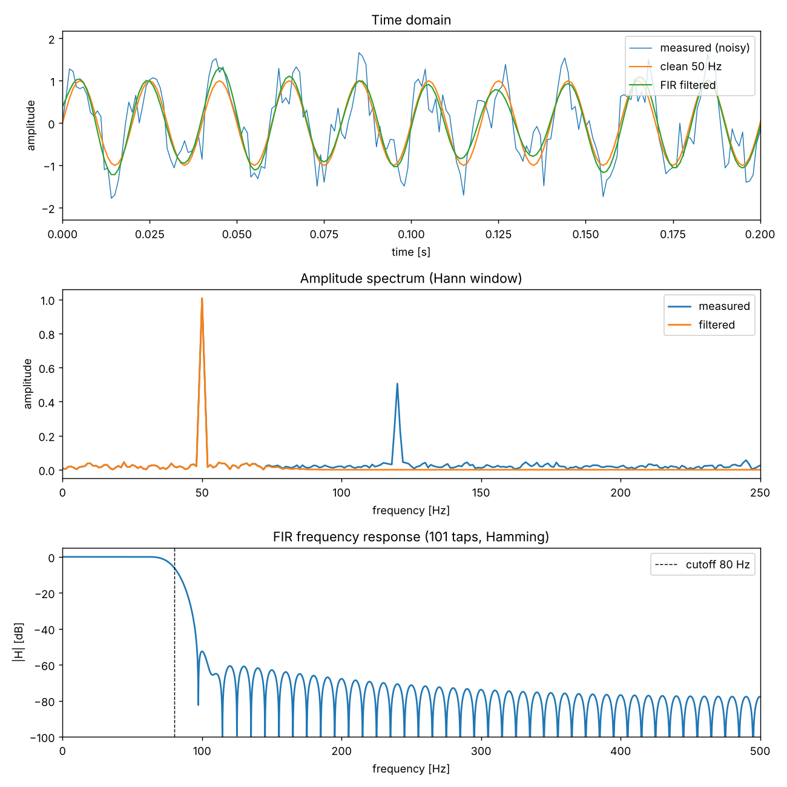

# FIR noise filter

Recovering a clean 50 Hz sensor tone from a recording corrupted by power-line
harmonic interference and broadband noise, using a linear-phase FIR low-pass
filter designed from first principles in Python.

**Interactive showcase:** https://m0hit-tvm.github.io/fir-noise-filter/
(plain-language walkthrough with live charts; source in `docs/`).



## Overview

| | |
|---|---|
| Sample rate | 1000 Hz |
| Wanted signal | 50 Hz sine, amplitude 1.0 |
| Interference | 120 Hz sine, amplitude 0.5, plus white Gaussian noise (σ = 0.3) |
| Filter | 101-tap windowed-sinc FIR, Hamming window, cutoff 80 Hz |
| Result | 120 Hz tone attenuated by about 61 dB; SNR improved from 3.6 dB to 15.7 dB |

## Run it

```bash
pip install -r requirements.txt
python fir_noise_filter.py
```

The script prints the detected spectral peaks, the filter characteristics,
the attenuation at both tones and the SNR before and after, and saves
`plots/fir_filter.png`.

## Method

1. **Signal synthesis.** One second of the measured signal is generated with a
   fixed random seed so results are reproducible.
2. **Spectral analysis.** A single-sided amplitude spectrum is computed with
   `rfft` on a Hann-windowed record, scaled by `2 / sum(w)` so that a sine of
   amplitude A appears as a peak of height A. Peaks are picked automatically.
3. **Filter design.** The ideal low-pass impulse response
   `h[n] = 2 fc/fs · sinc(2 fc/fs · (n − M/2))` is truncated to 101 taps,
   shaped with a symmetric Hamming window and normalised to unity DC gain.
   The hand-built taps match `scipy.signal.firwin` to machine precision,
   which is checked at run time.
4. **Filtering.** The filter is applied by direct convolution. The symmetric
   taps give a constant group delay of (N−1)/2 = 50 samples, which is removed
   by trimming so the output lines up with the input. A zero-phase
   `filtfilt` pass is included for comparison.
5. **Evaluation.** The frequency response is evaluated with `freqz` at both
   tones, and SNR is computed against the known clean signal with the
   filter's start-up transient excluded.

## Design notes

These are the engineering decisions behind the implementation and the
reasoning for each.

* **Sampling.** The highest component present (120 Hz) is far below the
  500 Hz Nyquist limit, so no aliasing occurs in the digital domain. In a
  real acquisition chain an analog anti-aliasing filter ahead of the ADC is
  still required for broadband sensor noise.
* **Windowing before the FFT.** The record length is not an integer number
  of periods of every component, so a rectangular window leaks energy into
  neighbouring bins. The Hann window trades a slightly wider main lobe for
  much lower side lobes, which keeps the small 120 Hz tone visible above the
  leakage of the 50 Hz tone.
* **FIR rather than IIR.** FIR filters are unconditionally stable and, with
  symmetric taps, exactly linear-phase, so the waveform shape of the wanted
  tone is preserved. An IIR design would reach the same stop-band attenuation
  with far fewer coefficients, at the cost of non-linear phase and potential
  numerical issues at high order.
* **Transition width and tap count.** For a Hamming window the transition
  band is approximately `3.3 · fs / N`, about 33 Hz for 101 taps at 1 kHz.
  This places the 50 Hz tone comfortably in the pass-band and the 120 Hz tone
  deep in the stop-band. More taps would sharpen the cutoff at the cost of
  more delay and more multiply-accumulates per sample.
* **Group delay.** Every frequency is delayed by exactly 50 samples (50 ms).
  Trimming the leading samples re-aligns the output for offline analysis.
  `filtfilt` achieves zero phase by filtering forwards and backwards, but it
  squares the magnitude response and cannot run in real time.
* **DC normalisation.** Truncating and windowing the ideal sinc slightly
  changes its DC gain, so the taps are rescaled to sum to one, giving exactly
  0 dB in the pass-band.
* **Embedded implementation.** On a microcontroller the same filter is a
  circular buffer of the last N inputs and a multiply-accumulate loop, in
  fixed point if no FPU is available. Tap symmetry halves the multiplies.
* **SNR definition.** Signal power over error power in dB, where the error
  is the difference from the clean reference. Samples affected by the
  filter's edge transient are excluded so the metric reflects steady-state
  performance.

## Companion project

[hammer-test](https://github.com/m0hit-tvm/hammer-test): identifying the
natural frequency and damping of a mechanical system from an impact test.
